# Согласованные макеты CheckOverlay · 19 ноября 2026

Версия дизайна 1.1. Дизайн согласован владельцем проекта; ТЗ и этот снимок передаются на приёмку PR перед изменением кода.

[ТЗ v1.1](../../mvp-spec.md) · [Описание дизайна](../../design.md) · [Реестр файлов](manifest.json) · [Параметры](tokens.json)

26 состояний, PNG в масштабе 1×. Примеры задач заменены нейтральными; оформление и граничные длины сохранены. Поля 80/80 и 102/80 содержат именно указанное количество символов. Размеры — логические пиксели при масштабе Windows 100%. Публикуются состояния, а не запись работающего приложения.

Эталоны: 00 — список; 18 — иконка импорта и прокрутка; 08 — плашка с отменой. На 19 объединены новый TXT и сохранённые списки. 22/25 — уведомления поверх списка с автоскрытием 2,5 с, а не отдельные страницы успеха. Экран 24 удалён и в поставку макетов не входит.

| Макет | Размер |
|---|---|
| [Главный экран · Montserrat Alternates](screens/00-main.png) | 320 × 470 |
| [01 · Компактный режим / 100 × 100](screens/01-compact-default.png) | 100 × 100 |
| [Добавление задачи · Montserrat Alternates](screens/02-add-task.png) | 320 × 470 |
| [Длинные задачи · 80 / 80 символов](screens/03-long-task-80.png) | 320 × 550 |
| [04 · Новая задача сохранена](screens/04-task-saved.png) | 320 × 518 |
| [05 · Изменение задачи в строке](screens/05-edit-inline.png) | 320 × 470 |
| [06 · Подтверждение удаления](screens/06-delete-confirmation.png) | 320 × 470 |
| [07 · Больше не спрашивать](screens/07-delete-no-confirm.png) | 320 × 470 |
| [08 · Задача удалена / Отмена](screens/08-delete-toast.png) | 320 × 470 |
| [09 · Пустой список](screens/09-empty-list.png) | 320 × 470 |
| [10 · Настройки / Общие](screens/10-settings-general.png) | 320 × 470 |
| [11 · Настройки / Внешний вид](screens/11-settings-appearance.png) | 320 × 470 |
| [12 · Настройки / Иконка](screens/12-settings-icon.png) | 320 × 470 |
| [13 · Меню трея и компактного режима](screens/13-tray-menu.png) | 240 × 265 |
| [14 · Иконка / своё изображение](screens/14-custom-icon.png) | 320 × 470 |
| [15 · Компактный режим / своё изображение](screens/15-compact-custom.png) | 100 × 100 |
| [16 · Ошибка выбора изображения](screens/16-image-error.png) | 320 × 470 |
| [17 · Выбор своего цвета](screens/17-color-picker.png) | 320 × 470 |
| [18 · Список / импорт в шапке и тонкий скролл-бар](screens/18-list-scrollbar.png) | 320 × 470 |
| [19 · Новый импорт / TXT и сохранённые списки](screens/19-import-home.png) | 320 × 758 |
| [20 · Новый импорт / имя и предпросмотр](screens/20-import-preview.png) | 320 × 730 |
| [21 · Импорт / правка длинной строки](screens/21-import-inline-edit.png) | 320 × 730 |
| [22 · Список / уведомление об импорте · 2,5 с](screens/22-import-toast.png) | 320 × 470 |
| [23 · Импорт / в файле нет задач](screens/23-import-empty.png) | 320 × 550 |
| [25 · Список / повторный импорт · уведомление](screens/25-import-repeat-toast.png) | 320 × 470 |
| [26 · Импорт / имя уже занято](screens/26-import-name-conflict.png) | 320 × 730 |

## Главный экран · Montserrat Alternates

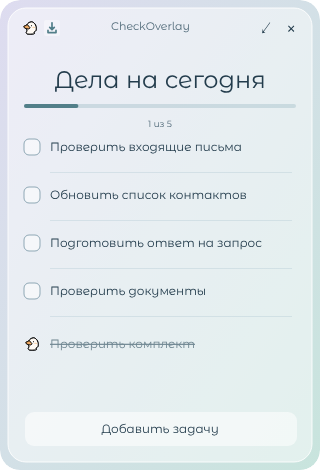

## 01 · Компактный режим / 100 × 100

## Добавление задачи · Montserrat Alternates

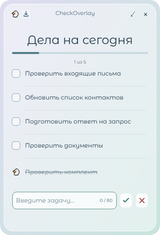

## Длинные задачи · 80 / 80 символов

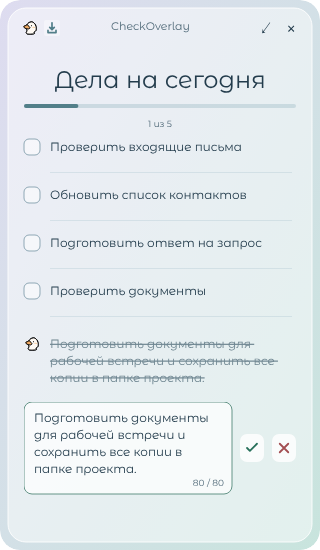

## 04 · Новая задача сохранена

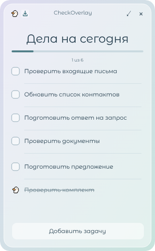

## 05 · Изменение задачи в строке

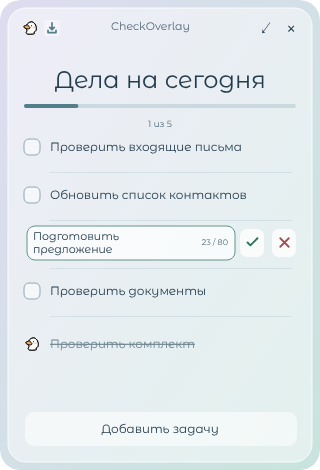

## 06 · Подтверждение удаления

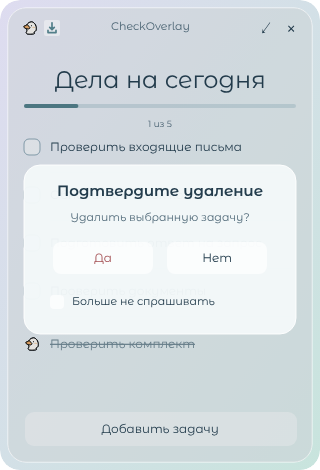

## 07 · Больше не спрашивать

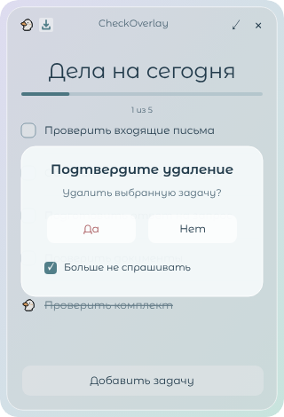

## 08 · Задача удалена / Отмена

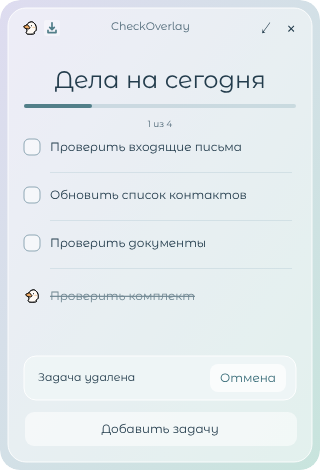

## 09 · Пустой список

## 10 · Настройки / Общие

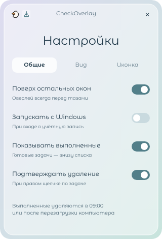

## 11 · Настройки / Внешний вид

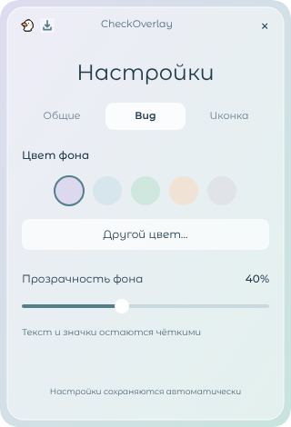

## 12 · Настройки / Иконка

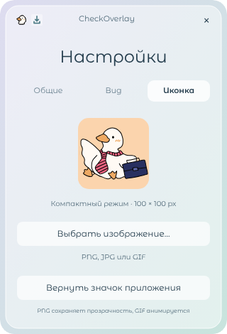

## 13 · Меню трея и компактного режима

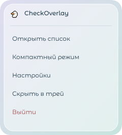

## 14 · Иконка / своё изображение

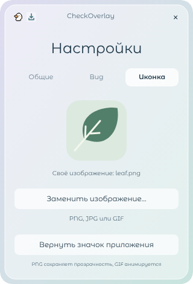

## 15 · Компактный режим / своё изображение

## 16 · Ошибка выбора изображения

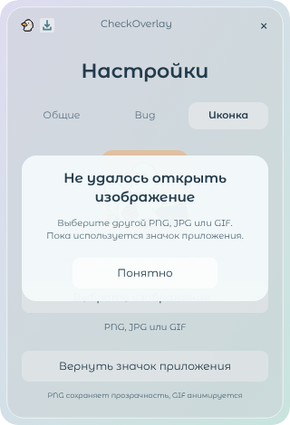

## 17 · Выбор своего цвета

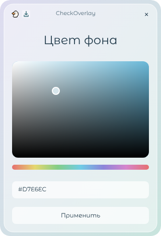

## 18 · Список / импорт в шапке и тонкий скролл-бар

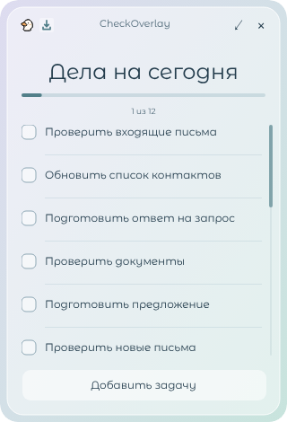

## 19 · Новый импорт / TXT и сохранённые списки

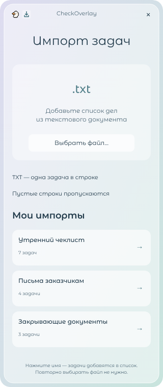

## 20 · Новый импорт / имя и предпросмотр

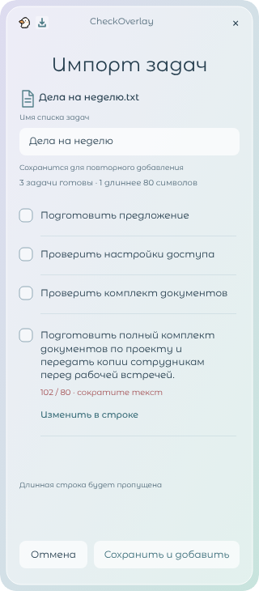

## 21 · Импорт / правка длинной строки

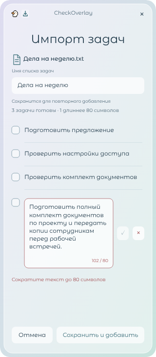

## 22 · Список / уведомление об импорте · 2,5 с

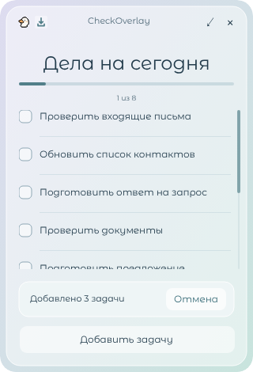

## 23 · Импорт / в файле нет задач

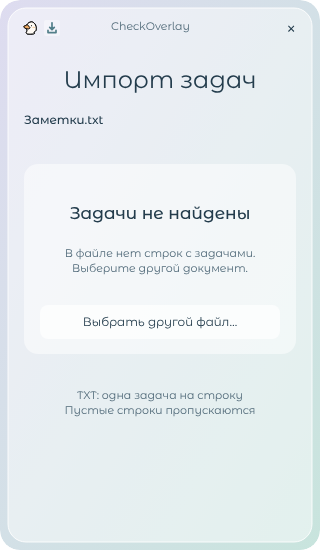

## 25 · Список / повторный импорт · уведомление

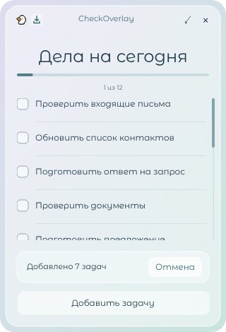

## 26 · Импорт / имя уже занято

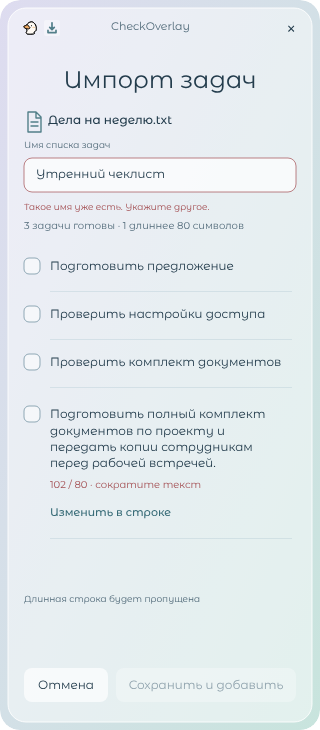
